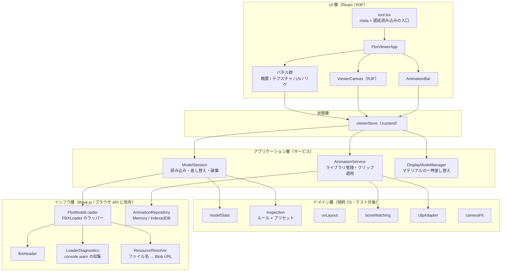
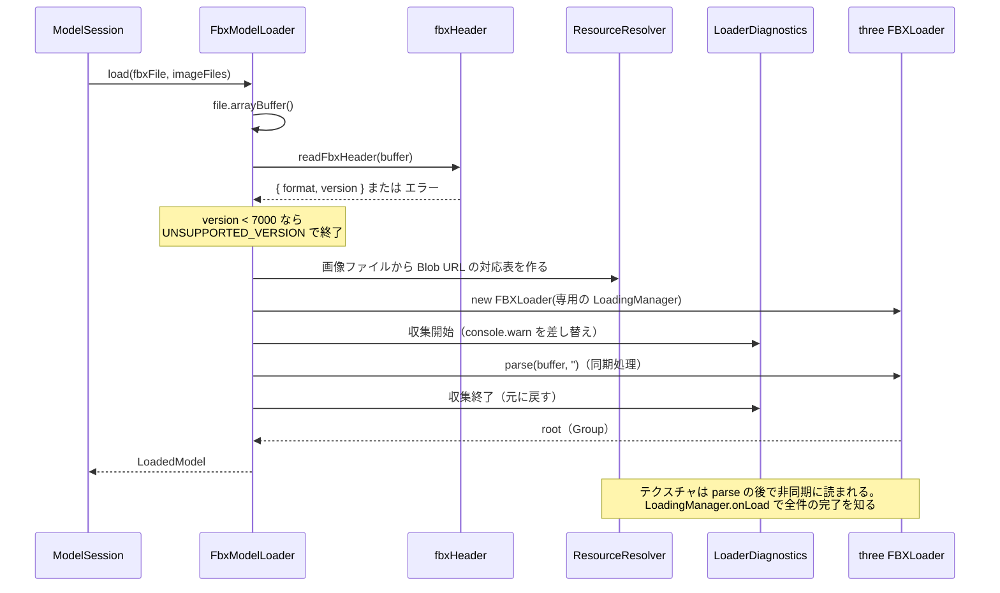
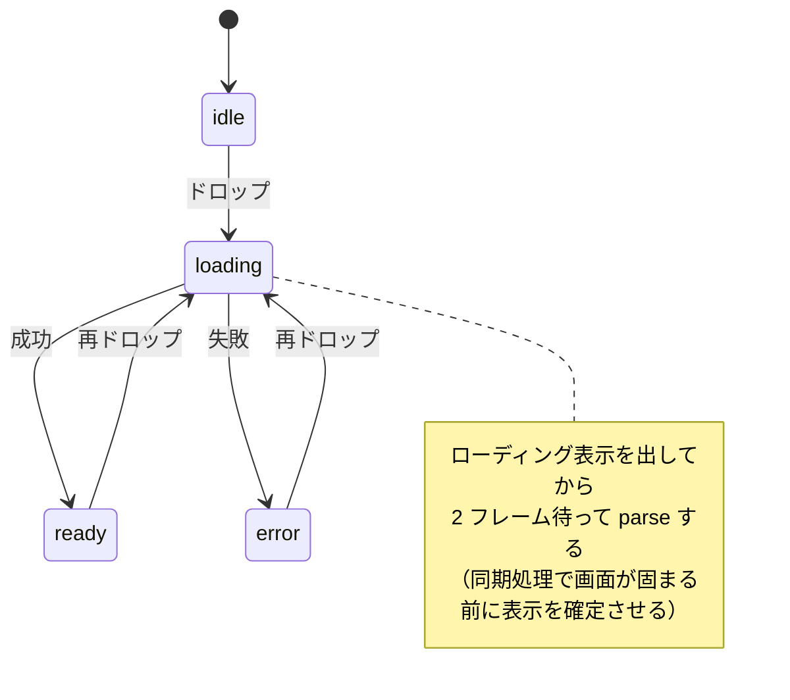
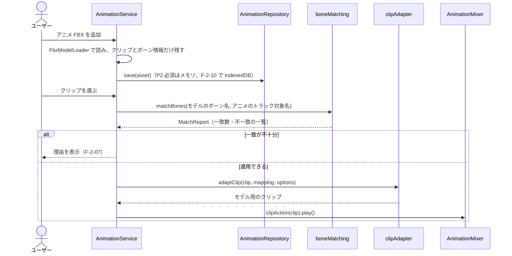
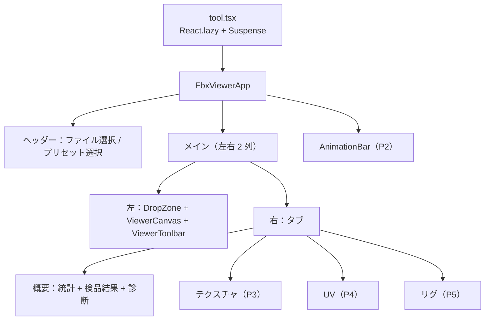

# FBX ビューア 設計書

| 項目         | 内容                                                                               |
| ------------ | ---------------------------------------------------------------------------------- |
| ドキュメント | 設計書（[要件定義書](./requirements.md) の次の段階）                               |
| 対象ツール   | `src/tools/fbx-viewer/`（slug: `fbx-viewer`）                                      |
| ステータス   | 実装済み（P1〜P5）。画面は [§15](#15-画面設計-v2vs-code-風ワークベンチ) で作り直し |
| 最終更新     | 2026-10-15                                                                         |

この設計書では、要件 ID（`F-1-01` など）と検品項目 ID（`C-01` など）を[要件定義書](./requirements.md)の ID で参照する。

---

## 1. 設計方針

| 方針                                             | 内容                                                                                                                                                                 |
| ------------------------------------------------ | -------------------------------------------------------------------------------------------------------------------------------------------------------------------- |
| **ロジックと描画を分ける**                       | 解析・検品・ボーン照合・クリップ変換は、React にも WebGL にも依存しない純粋な TypeScript で書く。Vitest（jsdom）でそのままテストできるようにする                     |
| **three.js への依存を 1 か所に閉じ込める**       | FBXLoader の癖（警告の出し方・テクスチャの読み方）を扱うコードは「インフラ層」だけに置く。three.js を上げたときの影響範囲を小さくする                                |
| **差し替えられる部品はインターフェースで受ける** | アニメライブラリの保存先（メモリ / IndexedDB）、検品ルール、表示モードは、インターフェースを決めて実装を差し替えられるようにする（依存性逆転の原則・開放閉鎖の原則） |
| **重い依存は遅延読み込み**                       | three.js 一式は、ツールのページを開いたときに初めて読み込む（NF-05）                                                                                                 |
| **テンプレートへの変更は最小限**                 | 共有部分の変更は「ツールページの横幅を広げるオプション」の 1 点だけにする（§6.1）                                                                                    |

---

## 2. 技術選定

### 2.1 追加する依存パッケージ

テンプレートは React 18 を使っている。React 19 への更新はこのツールのスコープ外とし、**React 18 に対応する最新系列**を選ぶ。

| パッケージ           | バージョン | 用途                                            | 選定理由                                                                  |
| -------------------- | ---------- | ----------------------------------------------- | ------------------------------------------------------------------------- |
| `three`              | `~0.186.1` | 3D 描画、FBXLoader、TGALoader                   | 現行の最新。FBXLoader の挙動に依存するので、パッチ版の更新のみ許可（`~`） |
| `@types/three`       | `~0.186.0` | 型定義                                          | `three` と系列を合わせる                                                  |
| `@react-three/fiber` | `^8.18.0`  | three.js を React で扱う                        | v9 は React 19 専用。React 18 では v8 が最新                              |
| `@react-three/drei`  | `^9.122.0` | OrbitControls、GizmoHelper、Grid など           | fiber v8 に対応するのは v9 系                                             |
| `zustand`            | `^5.0.0`   | 状態管理                                        | 理由は §2.2                                                               |
| `idb-keyval`         | `^6.2.0`   | IndexedDB の薄いラッパー（P2 の F-2-10 で導入） | 約 600 バイトと小さく、API が単純                                         |

### 2.2 状態管理に zustand を使う理由

前回は「最初は React の state で、必要になったら zustand」と書いたが、設計した結果、**最初から zustand を使う**ことにした。

- 3D ビュー・右パネル・アニメバーの 3 か所が、同じモデルや選択状態を参照する。React の state だけで持つと、props のバケツリレーか Context になる。
- アニメの再生時間は毎フレーム変わる。Context に入れると、そのたびに画面全体が再描画される。zustand ならセレクタで「必要な値が変わった部品だけ」を再描画できる。
- ストアが React の外にあるので、R3F の `useFrame` の中から `getState()` で読み書きでき、再描画を起こさない。

### 2.3 使わないもの

| 候補                               | 使わない理由                                                                                                                          |
| ---------------------------------- | ------------------------------------------------------------------------------------------------------------------------------------- |
| drei の `<Environment preset=...>` | HDR 画像を外部 CDN から取得する。外部への通信をなくすため、three.js 付属の `RoomEnvironment`（その場で生成する環境マップ）を使う      |
| drei の `<Bounds>`（自動フィット） | 「再ドロップしてもカメラを保持する」要件（要件定義書 §2.2）と相性が悪い。カメラ合わせは純粋関数で自作し、テストする                   |
| Web Worker での FBX 解析           | FBXLoader はテクスチャ生成に DOM（`Image`）を使うため、Worker でそのまま動かせない。P1 で解析時間を測り（§9）、問題があれば再検討する |

---

## 3. アーキテクチャ

### 3.1 レイヤー構成



### 3.2 依存のルール

- 矢印は「上が下を使う」向きだけ。**ドメイン層は他のどの層も知らない。**
- ドメイン層が three.js から使ってよいのは、データ構造と数学（`Object3D`, `BufferGeometry`, `AnimationClip`, `Box3`, `Vector3` など）だけ。`WebGLRenderer`、`TextureLoader`、DOM は使わない。これで jsdom 上の Vitest で動く。
- インフラ層の部品（`AnimationRepository` など）は、アプリケーション層が定義したインターフェースを実装する。

### 3.3 SOLID 原則との対応

| 原則                      | この設計での適用                                                                                                                                |
| ------------------------- | ----------------------------------------------------------------------------------------------------------------------------------------------- |
| 単一責任（S）             | 「読み込み」「解析」「検品」「表示の切り替え」「アニメ適用」を別モジュールにする。例：`FbxModelLoader` は読み込みだけを担当し、統計は計算しない |
| 開放閉鎖（O）             | 検品項目は `InspectionRule` を 1 ファイル追加して配列に登録するだけで増やせる。表示モードも `DisplayMode` を追加するだけで増やせる              |
| リスコフの置換（L）       | `AnimationRepository` のメモリ実装と IndexedDB 実装は、呼び出し側から同じように扱える（どちらも非同期 API に統一する）                          |
| インターフェース分離（I） | 検品ルールには、モデル全体ではなく必要な情報だけを持つ `InspectionContext` を渡す                                                               |
| 依存性逆転（D）           | `AnimationService` は `AnimationRepository` インターフェースに依存し、IndexedDB の詳細を知らない                                                |

---

## 4. ディレクトリ構成

テンプレートの規約は「ロジックは `logic.ts` に置く」だが、このツールは規模が大きいので `logic/` フォルダに分ける（規約の拡張として扱う）。

```
src/tools/fbx-viewer/
  tool.tsx                    ← meta と、FbxViewerApp を React.lazy で読む入口だけ
  FbxViewerApp.tsx            ← レイアウトの組み立て
  store/
    viewerStore.ts            ← zustand のストア（スライスごとにファイルを分けてもよい）
  ui/                         ← React コンポーネント（表示のみ）
    DropZone.tsx
    ViewerToolbar.tsx
    panels/
      OverviewPanel.tsx       ← 統計 + 検品結果
      TexturePanel.tsx        ← P3
      UvPanel.tsx             ← P4
      RigPanel.tsx            ← P5
    animation/
      AnimationBar.tsx
      AnimationLibraryDialog.tsx
  viewer/                     ← R3F コンポーネント（3D 描画のみ）
    ViewerCanvas.tsx
    ModelView.tsx
    Helpers.tsx               ← グリッド・ギズモ・スケルトン表示
    AnimationDriver.tsx       ← useFrame で AnimationMixer を進める
  services/                   ← アプリケーション層
    ModelSession.ts
    AnimationService.ts
    DisplayModeManager.ts
    displayModes/             ← 表示モードの実装（通常 / ワイヤー / チェッカー / ウェイト…）
  infra/                      ← インフラ層
    FbxModelLoader.ts
    fbxHeader.ts
    LoaderDiagnostics.ts
    ResourceResolver.ts
    AnimationRepository.ts    ← インターフェース + MemoryAnimationRepository
    IdbAnimationRepository.ts ← P2（F-2-10）
  logic/                      ← ドメイン層（純粋 TS）
    modelStats.ts
    cameraFit.ts
    units.ts
    inspection/
      types.ts
      presets.ts
      runInspection.ts
      rules/                  ← 1 ルール 1 ファイル（polygonCount.ts など）
    uvLayout.ts               ← P4
    boneMatching.ts           ← P2
    clipAdapter.ts            ← P2
    boneWeights.ts            ← P5
    *.test.ts                 ← 各モジュールの隣にテストを置く
  errors.ts                   ← エラーコードと日本語メッセージ
```

---

## 5. 主要モジュールの設計

### 5.1 ファイルの受け付け（F-1-01〜03, F-1-07）

ドロップまたはファイル選択で受け取った `File[]` を、拡張子で振り分ける。

```ts
// logic/fileIntake.ts（純粋関数）
type IntakeResult = {
  models: File[]; // .fbx
  images: File[]; // .png .jpg .jpeg .tga .psd
  ignored: File[]; // それ以外（画面に「無視したファイル」として出す）
};
function classifyFiles(files: File[]): IntakeResult;
```

**モデルとアニメの区別**は、受け口で決める（中身から推測しない）。

| 受け口                                                             | 扱い                                                                                      |
| ------------------------------------------------------------------ | ----------------------------------------------------------------------------------------- |
| 3D ビュー全体（メインのドロップ領域）／「ファイルを選択」ボタン    | **モデル**として読む。FBX が複数あるときは先頭の 1 つをモデルとし、残りは無視して通知する |
| アニメバーの「アニメを追加」ボタン／アニメライブラリのドロップ領域 | **アニメ**として読む。メッシュは捨て、クリップとボーン情報だけを残す                      |

中身から推測しない理由：Mixamo の「With Skin」で書き出したアニメ FBX にはメッシュが含まれるため、メッシュの有無では区別できない。

### 5.2 FBX の読み込み（`infra/FbxModelLoader.ts`）



#### ファイルヘッダの読み取り（`fbxHeader.ts`）

FBXLoader は古いバージョンに英語の例外を投げるだけなので、**解析の前に**自分でヘッダを読んで判定し、日本語のエラーにする。数十バイトしか読まないので速い。

| 形式           | 判定方法                                                                                                    |
| -------------- | ----------------------------------------------------------------------------------------------------------- |
| バイナリ       | 先頭が `Kaydara FBX Binary  \0` なら、オフセット 23 の uint32（リトルエンディアン）がバージョン（例：7400） |
| ASCII          | 先頭付近の `FBXVersion: 7400` を読む                                                                        |
| どちらでもない | `NOT_FBX` エラー                                                                                            |

#### 外部テクスチャの解決（`ResourceResolver.ts`）

- 一緒にドロップされた画像から「**小文字にしたファイル名 → Blob URL**」の対応表を作る。
- 読み込みごとに新しい `LoadingManager` を作り、`setURLModifier` で URL を差し替える。FBX に書かれたパス（`C:\work\tex\body.png` や `textures/body.png`）から**ファイル名だけ**を取り出して対応表を引く。
- 見つからなかったファイル名は記録する（C-10 と F-3-05 で使う）。差し替え先として 1×1 のマゼンタ画像の data URL を返す。これで「欠落テクスチャはマゼンタ表示」（F-3-05）が追加の処理なしで実現できる。
- TGA は `manager.addHandler(/\.tga$/i, new TGALoader(manager))` で対応する。PSD は読めないので、マゼンタ画像を返して「PSD は未対応」と記録する。
- 作った Blob URL は `dispose()` ですべて `URL.revokeObjectURL` する（NF-07）。

#### ローダーの警告の収集（`LoaderDiagnostics.ts`）

FBXLoader は重要な情報を `console.warn` でしか知らせない（three.js r186 のソースで確認）。`parse()` は同期処理なので、その間だけ `console.warn` を差し替えて警告を集め、`finally` で必ず元に戻す。

| 警告メッセージ（一部一致で判定）       | 変換後のコード            | 使い道                                                                                              |
| -------------------------------------- | ------------------------- | --------------------------------------------------------------------------------------------------- |
| `Z-UP coordinate system`               | `Z_UP_CORRECTED`          | ローダーがルートを X 軸 -90° 回転させたことが分かる。C-05 でこの回転を除外する                      |
| `more than 4 skinning weights`         | `WEIGHTS_TRUNCATED`       | C-31。**ジオメトリごとに 1 回しか出ない**ため、頂点数までは分からない（「該当あり」とだけ表示する） |
| `layered textures are not supported`   | `LAYERED_TEXTURE`         | 診断として表示                                                                                      |
| `animation stack with multiple layers` | `MULTI_LAYER_ANIMATION`   | 診断として表示                                                                                      |
| `invalid (negative) material indices`  | `NEGATIVE_MATERIAL_INDEX` | 診断として表示                                                                                      |
| 上記以外                               | `OTHER`（原文を保持）     | 「ローダーの警告」として原文のまま表示                                                              |

警告文に依存するのはこのクラスだけにする。three.js を上げたときは、このクラスのテストを更新すれば影響を確認できる。

#### 読み込み結果

```ts
interface LoadedModel {
  root: Group; // FBXLoader が返したルート
  source: { fileName: string; fileSize: number; format: 'binary' | 'ascii'; version: number };
  unitScaleFactor: number; // root.userData.unitScaleFactor。なければ 1（= cm）
  diagnostics: LoaderDiagnostic[];
  textures: TextureRecord[]; // マテリアルごとのテクスチャ一覧（P3 で使う）
  missingResources: string[]; // 見つからなかったファイル名
  texturesReady: Promise<void>; // テクスチャの非同期読み込みの完了
  dispose(): void; // ジオメトリ・マテリアル・テクスチャ・Blob URL を解放
}
```

### 5.3 単位の扱い（F-1-22, F-1-23, C-03）

FBXLoader は `UnitScaleFactor`（1 単位が何 cm か）を記録するだけで、モデルには適用しない。Unity は「ファイルの単位 × `UnitScaleFactor / 100`」でメートルに換算する。

**このツールの方針：** モデルをグループで包み、そのグループのスケールを `unitScaleFactor / 100` にする。こうすると、**シーン全体を常にメートルで扱える**。

- グリッドの 1 マスがそのまま 1 m になる
- バウンディングボックスの値がそのまま Unity での大きさ（m）になる
- カメラの near / far を固定値に近い範囲で決められる

```ts
// logic/units.ts
function fileUnitsToMeters(unitScaleFactor: number): number; // unitScaleFactor / 100
```

### 5.4 ModelSession（読み込み・差し替え・破棄：F-1-04〜06）

モデルのライフサイクルを 1 か所で管理する。



- 再ドロップしたとき、新しいモデルの読み込みが**成功してから**古いモデルを `dispose()` する。失敗したら古いモデルを残す（NF-06）。
- 読み込み中にさらにドロップされたら、古い読み込みの結果は捨てる（読み込みごとに連番を振り、最新の番号以外は無視する）。
- 保持するもの：カメラ位置、表示モード、選択中のクリップ名、プリセット。
- 読み込み成功後、`modelStats` と `runInspection` を実行して結果をストアに入れる。テクスチャの読み込みが完了したら（`texturesReady`）、テクスチャ関連の検品（C-10, C-11）だけを再実行する。

### 5.5 統計（`logic/modelStats.ts`：F-1-20〜25）

```ts
interface ModelStats {
  meshes: MeshStat[]; // name, vertexCount, triangleCount, materialNames, isSkinned, hasUv0, hasUv1, hasNormal
  totals: {
    meshCount;
    vertexCount;
    triangleCount;
    materialCount;
    textureCount;
    boneCount;
    clipCount;
    morphTargetCount;
  };
  bounds: { sizeMeters: Vec3; minMeters: Vec3; maxMeters: Vec3 };
  unitScaleFactor: number;
  upAxis: 'Y' | 'Z'; // 診断 Z_UP_CORRECTED があれば 'Z'
}
function computeModelStats(
  root: Object3D,
  opts: { unitScale: number; zUpCorrected: boolean },
): ModelStats;
```

- 三角形数は「インデックスがあれば `index.count / 3`、なければ `position.count / 3`」。
- マテリアル数は、同じマテリアルを複数のメッシュが共有していても 1 と数える（`uuid` で重複を除く）。
- バウンディングボックスはアニメを再生する前（バインドポーズ）に計算する。

### 5.6 検品（`logic/inspection/`：C-01〜C-32）

#### 型

```ts
type Level = 'ok' | 'warn' | 'ng' | 'skip';

interface InspectionContext {
  // ルールに渡すのは必要な情報だけ（インターフェース分離）
  stats: ModelStats;
  meshes: ReadonlyArray<MeshFacts>; // ジオメトリから抜き出した事実（UV の範囲、ウェイト 0 の頂点数など）
  topLevelTransforms: ReadonlyArray<NodeTransform>;
  diagnostics: ReadonlyArray<LoaderDiagnostic>;
  textures?: ReadonlyArray<TextureFacts>; // テクスチャの読み込み完了後に入る
  preset: InspectionPreset;
}

interface InspectionRule {
  id: string; // 'C-01'
  title: string; // 'ポリゴン数'
  phase: 1 | 2 | 3 | 4 | 5; // 未実装フェーズのルールは登録しない
  evaluate(ctx: InspectionContext): RuleResult;
}

interface RuleResult {
  level: Level;
  message: string; // '12,340 / 20,000（62%）'
  targets?: string[]; // 該当するメッシュ名やテクスチャ名
}
```

`runInspection(ctx, rules)` はルールを順に評価して結果を並べるだけ。ルール 1 つが例外を投げても全体は止めず、そのルールを `skip`（理由つき）にする。

#### 判定ロジック

| ID   | 判定                                                                                                                                 | 補足                                                      |
| ---- | ------------------------------------------------------------------------------------------------------------------------------------ | --------------------------------------------------------- |
| C-01 | 三角形数 > 上限 → NG、> 上限 × 0.8 → 警告                                                                                            | 0.8 はプリセットの `warnRatio`                            |
| C-02 | マテリアル数 > 上限 → 警告                                                                                                           |                                                           |
| C-03 | 高さ（m）がプリセットの `[minHeight, maxHeight]` の外 → 警告                                                                         | cm と m の取り違えなら 100 倍ずれるので、確実に検出できる |
| C-04 | 原点がバウンディングボックスの底面中央から、水平に「幅と奥行きの大きい方 × 10%」以上、または垂直に「高さ × 5%」以上ずれている → 警告 | 割合はプリセットで変更可能                                |
| C-05 | 最上位のノードに、回転（0.1° 超）またはスケール ≠ 1（誤差 1e-4 超）が残っている → 警告                                               | ローダーが Z-up 補正のために付けた回転は除外する          |
| C-06 | UV0 がないメッシュがある → NG                                                                                                        |                                                           |
| C-07 | 法線がないメッシュがある → 警告                                                                                                      |                                                           |
| C-10 | `missingResources` が空でない → NG                                                                                                   |                                                           |
| C-11 | 幅か高さが上限超え → NG、2 のべき乗でない → 警告                                                                                     |                                                           |
| C-20 | UV が `[-ε, 1+ε]` の外にある → 警告                                                                                                  | タイリングで意図的に外に出すこともあるので NG にしない    |
| C-21 | UV を 512×512 の格子に塗り、2 回以上塗られたマスがある → 警告                                                                        | 近似判定。結果に「近似」と明記する                        |
| C-30 | ボーン数 > 上限 → 警告                                                                                                               |                                                           |
| C-31 | 診断に `WEIGHTS_TRUNCATED` がある → 警告                                                                                             | 頂点数は分からない（§5.2）                                |
| C-32 | スキンメッシュで、ウェイトの合計が 0 の頂点がある → NG                                                                               |                                                           |

#### プリセット（`presets.ts`）

要件定義書 §9 Q2 の仮の値をそのまま使う。

```ts
interface InspectionPreset {
  id: string;
  name: string; // 'モバイル（キャラ）'
  maxTriangles: number;
  maxMaterials: number;
  maxTextureSize: number;
  maxBones: number | null; // null はチェックしない
  heightRangeMeters: [number, number];
  warnRatio: number; // 0.8
  pivotTolerance: { horizontal: number; vertical: number }; // 0.1, 0.05
}
```

| ID                 | 名前                 | 三角形  | マテリアル | テクスチャ | ボーン | 高さの範囲（m） |
| ------------------ | -------------------- | ------- | ---------- | ---------- | ------ | --------------- |
| `mobile-character` | モバイル（キャラ）   | 20,000  | 3          | 2048       | 75     | 0.5〜3          |
| `mobile-prop`      | モバイル（背景小物） | 5,000   | 2          | 1024       | —      | 0.05〜5         |
| `pc`               | PC                   | 100,000 | 8          | 4096       | 150    | 0.05〜10        |

選んだプリセットは `localStorage` に保存する（F-0-03。zustand の `persist` ミドルウェアを使う）。

### 5.7 表示モード（`services/DisplayModeManager.ts`：F-1-13, F-1-15, F-3-04, F-4-04, F-5-03）

ワイヤーフレーム、テクスチャのチャンネル表示、チェッカー、ウェイトのヒートマップは、どれも「**メッシュのマテリアルを一時的に差し替えて、あとで戻す**」という同じ仕組みで実現できる。そこで、仕組みは `DisplayModeManager` に 1 つだけ作り、モードごとの違いは `DisplayMode` として切り出す（ストラテジーパターン）。

```ts
interface DisplayMode {
  id: string; // 'wireframe' | 'checker' | 'baseColorOnly' | 'boneWeight' ...
  /** 元のマテリアルを受け取り、表示用のマテリアルを返す。元のマテリアルは変更しない */
  createMaterial(original: Material, mesh: Mesh, params: DisplayParams): Material;
}

class DisplayModeManager {
  apply(root: Object3D, mode: DisplayMode, params: DisplayParams): void; // 元のマテリアルを WeakMap に退避して差し替え
  restore(root: Object3D): void; // 元に戻し、作ったマテリアルを dispose
}
```

| モード                                 | フェーズ   | 実装                                                                                                                     |
| -------------------------------------- | ---------- | ------------------------------------------------------------------------------------------------------------------------ |
| 通常                                   | P1         | 何もしない                                                                                                               |
| ワイヤーフレーム                       | P1         | 元のマテリアルを複製して `wireframe = true`                                                                              |
| 通常＋ワイヤー                         | P1         | 元のマテリアルはそのままにし、同じジオメトリを共有する子メッシュを重ねる（スキンメッシュは同じスケルトンに `bind` する） |
| 裏面の色付け                           | P1（任意） | `onBeforeCompile` で `gl_FrontFacing` が偽なら赤くする                                                                   |
| ベースカラーのみ / 法線マップのみ / 白 | P3         | `MeshBasicMaterial` に該当するテクスチャだけを貼る                                                                       |
| チェッカー                             | P4         | `DataTexture` で生成したチェッカー柄を貼る                                                                               |
| ボーンウェイト                         | P5         | 選んだボーンのウェイトを頂点カラーにして表示する。色の計算は `logic/boneWeights.ts`（純粋関数）                          |

マテリアルの差し替えはスキンメッシュでも動く（`SkinnedMesh` 側がスキニングを処理するため）。

### 5.8 3D 描画（`viewer/`：F-1-10〜16）

```
<Canvas frameloop={再生中なら 'always'、それ以外は 'demand'}>
  <ViewerLights />          ← HemisphereLight + DirectionalLight + RoomEnvironment
  <group scale={fileUnitsToMeters(unitScaleFactor)}>
    <primitive object={model.root} />
  </group>
  <Helpers />               ← Grid（1 マス 1 m）、GizmoHelper、SkeletonHelper
  <AnimationDriver />       ← useFrame で mixer.update(delta)
  <OrbitControls makeDefault />
</Canvas>
```

- **カメラ合わせ（F-1-11）：** `logic/cameraFit.ts` の純粋関数で、バウンディングボックスと画角から「全体が収まるカメラ位置と注視点」を計算する。初回読み込み時とリセットボタンのときだけ適用する（再ドロップではカメラを保持する）。
- **描画ループ：** 止まっているときは `frameloop="demand"` にして、操作があったときだけ描画する（CPU と電池の節約）。
- **背景色（F-1-14）：** `<color attach="background">` をストアの値で切り替える。

### 5.9 アニメーション（P2）

#### 全体の流れ



#### アニメの資産（`AnimationAsset`）とリポジトリ

```ts
interface AnimationAsset {
  id: string;
  name: string; // ファイル名
  origin: 'embedded' | 'library'; // モデル内蔵 / ライブラリ
  clips: AnimationClip[];
  boneNames: string[]; // アニメ側のボーン名
  rootBoneName: string | null; // 腰（Hips）のボーン名
  rootRestHeight: number | null; // 腰の初期の高さ（m）。移動量の補正に使う
}

interface AnimationRepository {
  // 依存性逆転：AnimationService はこれだけを知る
  list(): Promise<StoredAnimation[]>; // id, name, 追加日時
  load(id: string): Promise<ArrayBuffer>;
  save(name: string, data: ArrayBuffer): Promise<string>;
  remove(id: string): Promise<void>;
}
```

- **保存するのは FBX の生データ（`ArrayBuffer`）**。three.js のオブジェクトは保存できないので、開くたびに解析し直す。
- P2 の必須範囲はメモリ実装（`MemoryAnimationRepository`）。F-2-10 で `IdbAnimationRepository`（idb-keyval）に差し替える。呼び出し側は変更しない。

#### ボーン名の照合（`logic/boneMatching.ts`：F-2-05〜07）

FBXLoader は、ノード名から `[ ] . : /` を**削除**し、空白を `_` に置き換える（`PropertyBinding.sanitizeNodeName`）。そのため、Mixamo の `mixamorig:Hips` は three.js の中では **`mixamorigHips`** になる。区切り文字が消えているので、「`:` より前を消す」という汎用の処理はできない。照合の前に、既知の接頭辞の一覧を使って正規化する。

```ts
const KNOWN_PREFIXES = [/^mixamorig\d*/i]; // 必要に応じて追加（Tripo のリグの命名が分かったら追加：§10）

function normalizeBoneName(name: string): string;
// 1. 既知の接頭辞を除去       mixamorigLeftArm → LeftArm
// 2. 小文字にする             LeftArm → leftarm
// 3. _ - と空白を除去         left_arm → leftarm

function matchBones(modelBones: string[], animTargets: string[]): MatchReport;

interface MatchReport {
  mapping: Map<string, string>; // アニメ側の名前 → モデル側の名前
  matchedCount: number;
  animBoneCount: number;
  unmatchedAnim: string[];
  unmatchedModel: string[];
  verdict: 'ok' | 'partial' | 'no-skeleton' | 'no-match';
}
```

| 判定          | 条件                               | 画面の表示                                       |
| ------------- | ---------------------------------- | ------------------------------------------------ |
| `no-skeleton` | モデルにボーンがない               | 「このモデルにはリグがありません」               |
| `no-match`    | 腰が一致しない、または一致率 < 50% | 「ボーン名が一致しません」+ 不一致の一覧         |
| `partial`     | 一致率 50〜99%                     | 再生はする。一致しなかったボーンは動かないと表示 |
| `ok`          | 全ボーンが一致                     | 一致数を表示                                     |

50% はとりあえずの値。Tripo の自動リグで試して調整する（§10）。

#### クリップの変換（`logic/clipAdapter.ts`：F-2-05, F-2-08）

`AnimationMixer` は、トラック名（`ボーン名.quaternion` など）とモデルのノード名を突き合わせて動かす。そのため「トラック名をモデルのボーン名に書き換える」だけでアニメを当てられる。この処理は `AnimationClip` と `KeyframeTrack` だけで完結するので、純粋関数として Vitest でテストできる。

```ts
function adaptClip(
  clip: AnimationClip,
  report: MatchReport,
  opts: {
    rootBoneName: string; // モデル側の腰のボーン名
    rootMotion: boolean; // F-2-08
    rootScale: number; // 腰の移動量の倍率（下記）
  },
): AnimationClip;
```

| 処理                                 | 内容                                                       | 理由                                                           |
| ------------------------------------ | ---------------------------------------------------------- | -------------------------------------------------------------- |
| トラック名の書き換え                 | `mapping` に従ってボーン名を置き換える                     | 名前の違いを吸収する                                           |
| 一致しないトラックを捨てる           |                                                            | 存在しないボーンへのトラックは無駄                             |
| 回転（`quaternion`）は全ボーンで使う |                                                            | ポーズの本体                                                   |
| 位置（`position`）は腰だけ使う       | 腰以外は捨てる                                             | 骨の長さが違うと、位置トラックで体が伸び縮みしてしまう         |
| スケール（`scale`）は捨てる          |                                                            | 同上                                                           |
| 腰の位置に倍率を掛ける               | `rootScale` = モデルの腰の高さ ÷ アニメの腰の高さ          | 体格や単位（cm / m）の違いで、足が浮いたり沈んだりするのを防ぐ |
| ルートモーションがオフのとき         | 腰の位置の X・Z を最初のフレームの値に固定する（Y は残す） | その場で再生する。上下の揺れは残す                             |

> 腰の高さの比で補正する方式は、P2 の最初に実際の Mixamo アニメで検証する（§10）。

#### 再生の制御（F-2-02, F-2-03）

- `AnimationMixer` はモデルごとに 1 つ作り、モデルを差し替えたら `stopAllAction()` と `uncacheRoot()` で破棄する。
- 再生速度は `mixer.timeScale`、ループは `action.setLoop(LoopRepeat | LoopOnce)`。
- シークは `action.time = t` のあと `mixer.update(0)` を呼ぶ（一時停止中でもポーズが反映される）。
- **再生時間の表示：** 毎フレームストアを更新すると再描画が多いので、`useFrame` の中で `getState()` を使い、約 10Hz に間引いてストアの `currentTime` を更新する。
- **フレーム数の表示：** `AnimationClip` は元のフレームレートを持たないので、30fps として換算する（Mixamo の既定値）。fps は設定で変更できるようにしておく。
- 変換したクリップは「モデル × アニメ × オプション」をキーにキャッシュする。

### 5.10 テクスチャと UV（P3, P4）

- **テクスチャの一覧（F-3-01, F-3-02）：** マテリアルの `map`、`normalMap`、`specularMap`、`emissiveMap`、`bumpMap` などを走査して `TextureRecord`（マテリアル名・種類・解像度・埋め込みか外部か・欠落か）を作る。FBXLoader は Phong 系マテリアルに変換するので、元の PBR の金属度・粗さは別の名前のスロットに入る場合がある。実際の Tripo の FBX でスロットとの対応を確認する（§10）。
- **サムネイル：** `texture.image` を Canvas に描いて縮小する。TGA は `DataTexture`（画素の配列）なので、`ImageData` に変換して描く。この変換は `infra/textureImage.ts` に 1 つだけ作り、UV 表示と共有する。
- **UV レイアウト（F-4-01〜07）：** `logic/uvLayout.ts` で UV の三角形を `Float32Array` として取り出し、範囲外の面や重なりも純粋関数で求める。描画は 2D Canvas（WebGL は使わない）。PNG 保存は `canvas.toBlob()`。

---

## 6. 画面設計

### 6.1 テンプレートへの変更：ツールページの横幅

現在の `ToolPage` は中身の幅を `max-w-3xl`（768px）に制限している。3D ビューと右パネルを並べるには狭いので、**`ToolMeta` に省略可能な `layout` を追加**する。

```ts
// src/tools/types.ts
export interface ToolMeta {
  // ...既存の項目
  /** 任意。'wide' にすると、ツールページの最大幅の制限を外す。既定は 'default' */
  layout?: 'default' | 'wide';
}
```

- 既存のツール（文字数カウンター）は何も変えなくてよい（後方互換）。
- `ToolPage` は `meta.layout === 'wide'` のとき `max-w-3xl` を外す。
- `docs/adding-a-tool.md` に 1 行追記する。

### 6.2 コンポーネント構成



- 未実装のフェーズのタブは表示しない（「準備中」タブは作らない）。
- 画面の配置は要件定義書 §4 のワイヤーフレームに従う。
- E2E から参照しやすいよう、統計値には `data-testid`（`stat-triangles` など）を、検品結果の行には `data-testid="inspection-C-01"` と `data-level="ok|warn|ng"` を付ける。

### 6.3 アクセシビリティ

- ファイル選択は `<input type="file">` を `<label>` で包み、ドロップできない人でも使えるようにする（F-1-02）。E2E でもこれを使う。
- ドロップ領域には `aria-label="FBX ファイルのドロップ領域"` を付ける。
- 再生ボタンなどアイコンだけのボタンにはすべて `aria-label` を付ける。
- 検品結果は色だけで区別せず、アイコン（✅⚠️❌）と文字も併記する。

---

## 7. エラー処理

| コード                | 発生条件                    | 表示するメッセージ                                       | 復帰                             |
| --------------------- | --------------------------- | -------------------------------------------------------- | -------------------------------- |
| `NO_MODEL_FILE`       | ドロップに .fbx がない      | FBX ファイルが含まれていません                           | 待機に戻る                       |
| `NOT_FBX`             | ヘッダが FBX ではない       | FBX ファイルとして読み込めませんでした                   | 待機に戻る（直前のモデルは残す） |
| `UNSUPPORTED_VERSION` | バージョン < 7000           | FBX {version} は未対応です。7.0 以上で書き出してください | 同上                             |
| `PARSE_FAILED`        | FBXLoader が例外を投げた    | ファイルの解析に失敗しました（詳細：原文）               | 同上                             |
| `WEBGL_UNAVAILABLE`   | WebGL2 が使えない           | このブラウザでは 3D 表示ができません                     | 表示のみ                         |
| `ANIM_NO_CLIPS`       | アニメ FBX にクリップがない | このファイルにはアニメーションが含まれていません         | ライブラリに追加しない           |

- エラーコードと日本語メッセージの対応は `errors.ts` に集める。
- 予期しない例外は React の Error Boundary で受け止め、「ページを再読み込みしてください」と表示する（ツールのページの外側には影響させない）。

---

## 8. 性能とメモリ

| 項目                 | 対策                                                                                                                                                                                                                                                                    |
| -------------------- | ----------------------------------------------------------------------------------------------------------------------------------------------------------------------------------------------------------------------------------------------------------------------- |
| 初期表示（NF-05）    | `registry.ts` は `tool.tsx` を即時読み込みするので、`tool.tsx` では three.js を **値として import しない**（`import type` は消えるので可）。本体は `React.lazy(() => import('./FbxViewerApp'))` で読む。ビルド結果で、three.js が別ファイルに分かれていることを確認する |
| 解析中に画面が固まる | `parse()` は同期処理。ローディング表示を出してから 2 フレーム待って解析する。P1 で 50 万ポリゴン級の解析時間を計測する（§10）                                                                                                                                           |
| 描画負荷（NF-04）    | 停止中は `frameloop="demand"`。影は使わない                                                                                                                                                                                                                             |
| メモリ（NF-07）      | `LoadedModel.dispose()` でジオメトリ・マテリアル・テクスチャ・Blob URL を解放。`DisplayModeManager` が作ったマテリアルも解放する。E2E で 5 回読み込み直し、`renderer.info.memory` のジオメトリ数とテクスチャ数が増え続けないことを確認する                              |

---

## 9. テスト設計

### 9.1 ユニットテスト（Vitest / jsdom）

FBX ファイルがなくても、three.js のオブジェクトをテストの中で組み立てれば、ドメイン層はほぼすべてテストできる。

| 対象                                     | テストの作り方                              | 主なケース                                                                     |
| ---------------------------------------- | ------------------------------------------- | ------------------------------------------------------------------------------ |
| `fbxHeader`                              | 手で作ったバイト列・文字列                  | バイナリ 7400 / ASCII 7400 / 6100（未対応）/ FBX 以外                          |
| `fileIntake`                             | `new File([], 'a.FBX')` など                | 拡張子の大文字小文字、無視するファイル                                         |
| `ResourceResolver`                       | Blob URL の生成をモック                     | Windows パス・相対パス・大文字小文字の違い・欠落の記録                         |
| `LoaderDiagnostics`                      | `console.warn` を呼ぶ関数を渡す             | 警告の分類、例外時も元に戻ること                                               |
| `modelStats`                             | `BoxGeometry` や `SkinnedMesh` を組み立てる | インデックスあり / なし、マテリアルの重複除去、単位換算                        |
| 検品ルール                               | `InspectionContext` を直接作る              | 各ルールの境界値（上限ちょうど、80% ちょうど）                                 |
| `boneMatching`                           | ボーン名の配列                              | Mixamo の接頭辞（`mixamorig`, `mixamorig1`）、一致率の閾値、リグなし           |
| `clipAdapter`                            | `AnimationClip` を組み立てる                | トラック名の書き換え、腰以外の位置トラックの除去、ルートモーションのオフ、倍率 |
| `cameraFit` / `uvLayout` / `boneWeights` | 数値の入出力                                | 境界値・空のジオメトリ                                                         |

**FBXLoader との結合テスト：** サンプル FBX（§9.3）を jsdom 上で `parse()` し、統計が期待どおりになることを確認する。jsdom は画像を読み込まないが、例外にはならないので解析自体は検証できる。

### 9.2 E2E テスト（Playwright）

| テスト             | 内容                                                                                               |
| ------------------ | -------------------------------------------------------------------------------------------------- |
| 読み込み           | ファイル選択の `<input>` に `setInputFiles` でサンプルを渡し、`stat-triangles` などが期待値になる  |
| 検品               | `inspection-C-01` の `data-level` が期待どおり                                                     |
| エラー             | 拡張子だけ .fbx のテキストファイルで、エラーメッセージが出る。直前のモデルが残る                   |
| 差し替え           | 2 つのサンプルを順に読み、統計が切り替わる                                                         |
| アニメ（P2）       | アニメ用サンプルを追加し、再生すると時間表示が進む                                                 |
| スクリーンショット | モデルを読み込んだ状態を `screenshots/tool-fbx-viewer-loaded.png` に保存する専用の spec を追加する |

**WebGL の準備：** CI のヘッドレス Chromium では GPU がないので、ソフトウェア描画（SwiftShader）を使う。`playwright.config.ts` の `launchOptions.args` に `--use-angle=swiftshader` と `--enable-unsafe-swiftshader` を追加する（既存の `PW_EXECUTABLE_PATH` の分岐と共存させる）。

### 9.3 テスト用サンプル（要件 Q5：自作する方針）

公開リポジトリに置けるよう、**すべて自作する**。

| ファイル                   | 中身                                                        | 作り方                                                   | 使うフェーズ |
| -------------------------- | ----------------------------------------------------------- | -------------------------------------------------------- | ------------ |
| `cube.fbx`                 | UV・法線・マテリアル 1 つの立方体（ASCII 7.4）              | 生成スクリプト `scripts/fixtures/generate-fbx.ts` で出力 | P1           |
| `cube-missing-texture.fbx` | 外部テクスチャを参照する立方体                              | 同上                                                     | P3           |
| `not-fbx.fbx`              | 中身がただのテキスト                                        | 手書き                                                   | P1           |
| `rigged-bar.fbx`           | 2 本のボーンでスキンされた棒 + 簡単なアニメ（バイナリ 7.4） | **Blender で作成**（ユーザーに依頼：§10）                | P2           |

生成スクリプトの出力はリポジトリにコミットする（テストのたびに生成しない）。バイナリ形式の読み込みは `rigged-bar.fbx` で確認する。

---

## 10. 未決事項と検証項目

| No  | 内容                                                                                                                   | 対応                                                                                                                                  | 時期      |
| --- | ---------------------------------------------------------------------------------------------------------------------- | ------------------------------------------------------------------------------------------------------------------------------------- | --------- |
| V-1 | Blender の FBX 書き出しで、`UnitScaleFactor` と最上位ノードの回転・スケールがどうなるか（C-03, C-05 の誤検出がないか） | 書き出し設定を変えた数パターンで確認し、閾値を調整                                                                                    | P1        |
| V-2 | 50 万ポリゴン級の FBX の解析時間（NF-03）                                                                              | 計測し、5 秒を超えるなら Worker 化などを再検討                                                                                        | P1        |
| V-3 | CI のヘッドレス Chromium（SwiftShader）で WebGL が描画できるか                                                         | P1 の最初の PR で確認                                                                                                                 | P1        |
| V-4 | Tripo の FBX のマテリアル（PBR）が Phong のどのスロットに入るか                                                        | 実物の FBX で確認                                                                                                                     | P3        |
| V-5 | 腰の高さの比による移動量の補正が、Mixamo のアニメで破綻しないか                                                        | Mixamo のキャラ + アニメで確認                                                                                                        | P2        |
| Q3  | Tripo の自動リグのボーン名（`KNOWN_PREFIXES` に追加が必要か）                                                          | **ボーン名が分かるサンプル FBX を 1 つ依頼したい**。届くまでは Mixamo の命名を前提に進める                                            | P2 開始前 |
| Q4  | GLB 対応                                                                                                               | スコープ外。対応するときは `FbxModelLoader` と同じ形の `GltfModelLoader` を追加する（ドメイン層は `Object3D` しか見ないので変更不要） | P5 以降   |
| Q5  | `rigged-bar.fbx` の用意                                                                                                | Blender で 2 ボーンの棒を作って書き出してもらえると助かる。難しければ、生成スクリプトで ASCII 版を作る                                | P2 開始前 |

---

## 11. 実装計画（PR の分け方）

1 PR はレビューできる大きさに抑える。各 PR で `npm run check`・`npm run e2e`・スクリーンショットを通す。

| PR  | フェーズ | 内容                                                                                                                     | 主な要件                             |
| --- | -------- | ------------------------------------------------------------------------------------------------------------------------ | ------------------------------------ |
| 1   | P1       | 依存パッケージの追加、`ToolMeta.layout`、遅延読み込みの入口、ドロップ・読み込み・3D 表示・エラー表示、SwiftShader の設定 | F-1-01〜06, F-1-10〜14, NF-05, NF-06 |
| 2   | P1       | 統計、検品の仕組みと C-01〜C-07、プリセット、診断の表示                                                                  | F-1-20〜24, C-01〜07, F-0-01         |
| 3   | P2       | アニメライブラリ（メモリ）、ボーン照合、クリップ変換、再生の操作                                                         | F-2-01〜09                           |
| 4   | P2       | IndexedDB への保存                                                                                                       | F-2-10                               |
| 5   | P3       | テクスチャの一覧・表示モード・C-10/C-11                                                                                  | F-3-01〜05                           |
| 6   | P4       | UV レイアウト・チェッカー・C-20                                                                                          | F-4-01〜05                           |
| 7   | P5       | ボーンツリー・ウェイト表示・C-30〜C-32                                                                                   | F-5-01〜04                           |

---

## 12. 要件との対応表

| 要件                       | 主な担当モジュール                                                   |
| -------------------------- | -------------------------------------------------------------------- |
| F-1-01〜03, F-1-07         | `ui/DropZone`, `logic/fileIntake`, `infra/ResourceResolver`          |
| F-1-04〜06                 | `services/ModelSession`, `infra/FbxModelLoader`, `errors.ts`         |
| F-1-10〜12, F-1-14, F-1-16 | `viewer/ViewerCanvas`, `viewer/Helpers`, `logic/cameraFit`           |
| F-1-13, F-1-15             | `services/DisplayModeManager`                                        |
| F-1-20〜25                 | `logic/modelStats`, `ui/panels/OverviewPanel`                        |
| C-01〜C-32                 | `logic/inspection/rules/*`                                           |
| F-2-01〜04, F-2-10         | `services/AnimationService`, `infra/AnimationRepository`             |
| F-2-05〜08                 | `logic/boneMatching`, `logic/clipAdapter`                            |
| F-2-02〜03, F-2-09         | `viewer/AnimationDriver`, `ui/animation/AnimationBar`                |
| F-3-01〜06                 | `ui/panels/TexturePanel`, `infra/textureImage`, `DisplayModeManager` |
| F-4-01〜07                 | `logic/uvLayout`, `ui/panels/UvPanel`                                |
| F-5-01〜05                 | `ui/panels/RigPanel`, `logic/boneWeights`                            |
| F-0-01〜04                 | `logic/inspection/presets`, `store/viewerStore`（persist）           |
| NF-01〜10                  | §1, §8, §9                                                           |

---

## 14. 実装メモ（設計からの変更点）

実装してみて分かったことと、設計から変えた点。

| 項目                 | 設計                                                | 実装                                                                                           | 理由                                                                                                                                                                                                      |
| -------------------- | --------------------------------------------------- | ---------------------------------------------------------------------------------------------- | --------------------------------------------------------------------------------------------------------------------------------------------------------------------------------------------------------- |
| 外部テクスチャの解決 | `LoadingManager.setURLModifier` で URL を差し替える | `manager.addHandler` で**拡張子ごとのローダー**（`TrackingTextureLoader`）を差し込む           | FBXLoader は先に `manager.getHandler('.拡張子')` を見るため、ここで受けると「どのテクスチャがどのファイルか」を確実に記録できる。URL の差し替えでは、読み込み前のテクスチャとファイル名を対応付けられない |
| 検品ルールのファイル | 1 ルール 1 ファイル                                 | カテゴリごとのファイル（`rules/geometry.ts` など）＋ `rules/index.ts` に登録                   | 1 ルールが十数行と小さく、ファイルが増えすぎるため。追加の手順（1 つ書いて配列に登録）は同じ                                                                                                              |
| 環境光               | `RoomEnvironment`                                   | ライト（半球光 + 平行光 2 つ）のみ                                                             | FBXLoader が作るマテリアルは Phong / Lambert で、環境マップを使わないため効果がない                                                                                                                       |
| 表示モード           | 裏面の色付け（任意）                                | 「法線の向き」（`MeshNormalMaterial`）で代替                                                   | 法線の向きが色で分かり、裏返った面も見つけられる。シェーダーの書き換えが不要                                                                                                                              |
| アニメの追加         | 何も選んでいなければ最初のクリップを選ぶ            | 追加したら**必ず**そのクリップを選んで再生                                                     | 「追加してすぐ確認する」使い方に合わせた                                                                                                                                                                  |
| テスト用サンプル     | リグ付きは Blender で作成を依頼                     | `scripts/fixtures/` の生成スクリプトで**バイナリ FBX 7.4** を直接書き出し（`npm run samples`） | リグ・スキン・アニメ・埋め込みテクスチャまで自作でき、公開しても問題ない。Blender の書き出し形式（バイナリ）の読み込みも確認できる                                                                        |
| ビルドの警告         | ―                                                   | `vite.config.ts` の `chunkSizeWarningLimit` を 1500KB に変更                                   | 遅延読み込みの three.js チャンク（約 1MB）で毎回警告が出るため。トップページのチャンクは約 170KB のまま                                                                                                   |

### three.js r186 の FBXLoader で確認した挙動

- Z-up のファイルは、ローダーがルートを X 軸 -90° 回転させる（C-05 ではこの回転を除外する）。
- 外部参照のテクスチャでも、FBX に `Video` ノードがないとファイル名を取得できず、空のテクスチャになる。
- 1 頂点 5 本以上のウェイトの警告は、ジオメトリごとに 1 回しか出ない（件数は分からない）。

## 15. 画面設計 v2（VS Code 風ワークベンチ）

「VS Code のように見やすく使いやすく」という要望を受けて、§6 の画面を作り直した。方針は次の 2 点（2026-10-15 に合意）。

- VS Code の構成に、Unity のような**インスペクター**（右側）を加える
- VS Code 風にするのは **FBX ビューアだけ**。トップページなどは今のまま

### 15.1 画面構成

```
┌──────────────────────────────────────────────────────────────────────┐
│ タイトルバー  ← 一覧  FBX ビューア   [> コマンドを検索 Ctrl+Shift+P]  ◧ ⬓ ◨ ☾ │
├──┬───────────┬──────────────────────────────────────┬───────────────┤
│Ac│ サイドバー  │ エディタ（タブ）[3D ビュー][UV: Body][body.png]│ インスペクター │
│ti│ エクスプロー│ ───────────────────────────────────── │ 選択中の詳細   │
│vi│ ラー / テク │                                      │（モデル・メッシ│
│ty│ スチャ / UV│            3D ビュー                  │ ュ・ボーン・マ │
│  │ / リグ / ア│                                      │ テリアル・テク │
│Ba│ ニメ / 設定 ├──────────────────────────────────────┤ スチャ・クリッ │
│r │            │ パネル [問題] [出力] [タイムライン]      │ プ）          │
├──┴───────────┴──────────────────────────────────────┴───────────────┤
│ ステータスバー ⊗1 ⚠3 │ body.fbx │ FBX 7.4 │ cm │ 180 tris │ プリセット │
└──────────────────────────────────────────────────────────────────────┘
```

| 領域               | 役割                                                                                        | 操作                                                                                             |
| ------------------ | ------------------------------------------------------------------------------------------- | ------------------------------------------------------------------------------------------------ |
| アクティビティバー | サイドバーのビューを切り替える（エクスプローラー / テクスチャ / UV / リグ / アニメ / 設定） | アクティブなアイコンをもう一度押すとサイドバーを閉じる（VS Code と同じ）                         |
| サイドバー         | ファイル・シーン階層・マテリアル・メッシュ・ボーン・アニメの一覧（ツリー）                  | 項目を選ぶとインスペクターに詳細が出る。UV・テクスチャはダブルクリックでエディタのタブとして開く |
| エディタ           | 3D ビュー（常に開いている）、UV エディタ、テクスチャビューアをタブで切り替える              | タブは × か中クリックで閉じる。3D ビューは閉じられない                                           |
| パネル             | 問題（検品結果）、出力（ローダーの診断・読み込みの記録）、タイムライン（アニメの再生）      | 境界をドラッグして高さを変える                                                                   |
| インスペクター     | 選んだものの詳細（プロパティの一覧）                                                        | 何も選んでいないときはモデルの概要と統計                                                         |
| ステータスバー     | 問題の件数、ファイル、形式、単位、三角形数、再生位置、プリセット                            | 問題の件数を押すと問題パネル、プリセットを押すと切り替え                                         |
| コマンドパレット   | すべての操作を名前で検索して実行する                                                        | Ctrl+Shift+P / F1                                                                                |
| 通知               | エラーなどを右下に出す（VS Code の通知と同じ位置）                                          | × で閉じる。内容は出力パネルにも残る                                                             |

- 3D ビューの中でメッシュをクリックすると選択できる（ドラッグでの回転とは区別する）。選択中のメッシュは枠で囲む。
- サイドバー・パネル・インスペクターの表示状態と大きさはブラウザに保存する。

### 15.2 状態の分け方

| ストア                   | 持つもの                                                                                 | 理由                                               |
| ------------------------ | ---------------------------------------------------------------------------------------- | -------------------------------------------------- |
| `viewerStore`（既存）    | モデル・解析結果・アニメ・3D の表示設定・**メッセージの記録**                            | ドメインの状態。画面の形には依存しない             |
| `workbenchStore`（新規） | どのビューやパネルを開いているか、大きさ、エディタのタブ、選択中のもの、コマンドパレット | 画面の形だけの状態。ドメインとは独立して作り直せる |

エラーとお知らせは、以前は 1 件ずつの文字列だったが、時刻付きの**メッセージの記録**に変えた。出力パネルは全件、通知は未読のエラー・警告だけを表示する。

### 15.3 ロジック（純粋関数・テスト対象）

| モジュール                 | 内容                                                                                         |
| -------------------------- | -------------------------------------------------------------------------------------------- |
| `logic/workbenchLayout.ts` | サイドバー・パネル・インスペクターの大きさの制限、エディタのタブを開く・閉じる・次に選ぶタブ |
| `logic/keybindings.ts`     | `Ctrl+Shift+P` のような表記の解析、キーボードイベントとの照合、表示用の文字列（Mac では ⌘）  |
| `logic/fuzzyMatch.ts`      | コマンドパレットのあいまい検索と並べ替え                                                     |
| `logic/sceneTree.ts`       | シーン階層のツリー（メッシュ・スキンメッシュ・ボーン・グループの種類つき）                   |

### 15.4 コマンドとショートカット

コマンドは `ui/workbench/commands.ts` に一覧として定義し、コマンドパレットとショートカットの両方から使う（同じ操作を 2 か所に書かない）。

| コマンド                                                                           | ショートカット                                                                             |
| ---------------------------------------------------------------------------------- | ------------------------------------------------------------------------------------------ |
| コマンドパレットを開く                                                             | Ctrl+Shift+P / F1                                                                          |
| ファイルを開く                                                                     | Ctrl+O                                                                                     |
| サイドバーの表示切り替え                                                           | Ctrl+B                                                                                     |
| パネルの表示切り替え                                                               | Ctrl+J                                                                                     |
| インスペクターの表示切り替え                                                       | Ctrl+Alt+B                                                                                 |
| エクスプローラー / 問題を表示                                                      | Ctrl+Shift+E / Ctrl+Shift+M                                                                |
| エディタのタブを閉じる                                                             | Alt+W（Ctrl+W はブラウザがタブを閉じる操作として予約しており、ページから止められないため） |
| 再生 / 一時停止                                                                    | Space                                                                                      |
| カメラを全体に合わせる                                                             | F                                                                                          |
| ワイヤーフレームの切り替え                                                         | W                                                                                          |
| 表示モード（通常・ベースカラー・法線マップ・白・法線の向き・チェッカー・ウェイト） | コマンドパレットから                                                                       |

入力欄にフォーカスがあるときは、文字キーのショートカット（Space・F・W）は効かないようにする。

### 15.6 実装メモ

- zustand v5 では、セレクタが毎回新しい配列を返すと（`s.x ?? []` など）無限に描き直しになる。空の値は定数（`NO_MATERIALS`）を返す。
- 3D ビューは、ほかのタブを開いても `visibility: hidden` で隠すだけにして、描画やアニメの状態を保つ。
- コマンドパレットの入力欄は、開いた瞬間にフォーカスする（次のフレームで移すと、すぐに打った文字が抜ける）。
- 遅延読み込み中の表示には `aria-busy="true"` を付け、スクリーンショットの撮影はそれが消えるまで待つ。

### 15.5 見た目

- 配色は VS Code の **Dark+ / Light+** に合わせる（エディタ #1e1e1e / #ffffff、サイドバー #252526 / #f3f3f3、ステータスバー #007acc など）。テーマの切り替え（§ダークモード）にそのまま従う。
- 色は Tailwind のクラスで書き、繰り返し使う組み合わせは `ui/workbench/styles.ts` に定数としてまとめる（独自 CSS ファイルは追加しない）。
- 文字は 13px を基本にし、一覧は 22px の行の高さで詰めて表示する。数値は等幅数字にする。
- アイコンは [lucide-react](https://lucide.dev/)（ISC ライセンス）を使う。
- テンプレートの `ToolMeta.layout` に `'fullscreen'` を追加し、ツールのページを画面いっぱいに使えるようにする（見出しとツール一覧へのリンクはタイトルバーに移す）。

- 足元の影は、毎フレーム描き直す方式（drei の ContactShadows）がこの環境で表示されなかったため、中心が濃い円形のぼかし影を地面に置く方式にした（軽く、どの環境でも同じに見える）。
- カメラ合わせは、外接球ではなくバウンディングボックスの 8 つの角をカメラの向きに投影して距離を決める（縦長のキャラでも余白が出すぎない）。

### 15.7 デモ用サンプル（2026-10-16 作り直し）

「デモモデルがダサい」という指摘を受けて、サンプルを作り直した。外部の CC0 素材サイトはこの環境から接続できないため、引き続き生成スクリプトで自作する（公開しても問題ない）。

| サンプル                                     | 内容                                                                                                                                                                                                                |
| -------------------------------------------- | ------------------------------------------------------------------------------------------------------------------------------------------------------------------------------------------------------------------- |
| 冒険者キャラクター（`sample-character.fbx`） | 回転体（カプセル・楕円体）を組み合わせた約 6,800 三角形のキャラ。なめらかな法線、関節で隣のボーンと混ざるウェイト（ひじ・ひざが自然に曲がる）、顔・服・ブーツを描いた 512px のテクスチャを埋め込み。Idle アニメ内蔵 |
| 木箱（`cube.fbx` + `cube_basecolor.png`）    | 検品で警告が出る例（原点が中心・ルートに回転・全面に同じ UV・外部テクスチャ）。テクスチャは板と補強材を描いた 300px（2 のべき乗ではない）                                                                           |

- 生成スクリプト：`scripts/fixtures/shapes.ts`（形とウェイト）、`painter.ts`（テクスチャの描画）、`character.ts`（キャラの組み立て）。
- FBX ライターは、128 バイトを超える配列を zlib で圧縮するようにした（Blender と同じ。キャラは 1MB → 366KB）。ローダーの圧縮配列の読み込みも確認できる。

### 15.8 シェーディングとライティング（2026-10-27 追加）

見た目の確認用に、シェーダーとライティングを切り替えられるようにした。表示モード（§5.7）の仕組みはそのままで、モードを増やしただけ。

| グループ | モード                                                     | 実装                                                                                                                                                                                  |
| -------- | ---------------------------------------------------------- | ------------------------------------------------------------------------------------------------------------------------------------------------------------------------------------- |
| 見た目   | Phong（読み込んだまま）                                    | FBXLoader が作ったマテリアルをそのまま使う                                                                                                                                            |
| 見た目   | PBR（Standard）                                            | `MeshStandardMaterial`（粗さ 0.65・金属度 0）。映り込みは three.js 付属の `RoomEnvironment` から作る環境マップ（外部の画像は読まない）                                                |
| 見た目   | トゥーン                                                   | `MeshToonMaterial` と 2 段の階調テクスチャ（影・光）                                                                                                                                  |
| 見た目   | トゥーン + 輪郭線                                          | トゥーンに、背面法の輪郭線を重ねる。法線の向きに膨らませた裏面だけを黒で描く（`onBeforeCompile` でスキニングの前に膨らませるので、アニメしても付いてくる）。太さはモデルの高さの 0.5% |
| 見た目   | MatCap（形の確認）                                         | 粘土調の `MeshMatcapMaterial`。MatCap の画像は DOM を使わずに画素を計算して作る                                                                                                       |
| 見た目   | アンリット                                                 | `MeshBasicMaterial`（ライトの影響なし）                                                                                                                                               |
| 確認用   | クレイ・法線マップ・法線の向き・チェッカー・ボーンウェイト | 従来どおり                                                                                                                                                                            |

- テクスチャ・法線マップ・色・透明度は、元のマテリアルから引き継ぐ。
- 輪郭線は頂点の法線で膨らませるため、法線が角ばっている（ハードエッジの）メッシュでは継ぎ目が割れて見えることがある。

ライティングはプリセット（スタジオ・屋外・夕方・夜・フラット）と、主光源の向きのスライダーで切り替える（`logic/lighting.ts`）。どちらもブラウザに保存する。これで要件 F-1-16 も満たす。

## 13. 参考リンク

- [three.js FBXLoader ソース（r186）](https://github.com/mrdoob/three.js/blob/r186/examples/jsm/loaders/FBXLoader.js)
- [three.js PropertyBinding.sanitizeNodeName](https://threejs.org/docs/#api/en/animation/PropertyBinding)
- [three.js AnimationMixer](https://threejs.org/docs/#api/en/animation/AnimationMixer) / [LoadingManager](https://threejs.org/docs/#api/en/loaders/managers/LoadingManager) / [RoomEnvironment](https://github.com/mrdoob/three.js/blob/dev/examples/jsm/environments/RoomEnvironment.js)
- [React Three Fiber v8 ドキュメント](https://r3f.docs.pmnd.rs/) / [Canvas の frameloop](https://r3f.docs.pmnd.rs/api/canvas)
- [drei](https://drei.docs.pmnd.rs/)
- [zustand](https://zustand.docs.pmnd.rs/) / [persist ミドルウェア](https://zustand.docs.pmnd.rs/integrations/persisting-store-data)
- [idb-keyval](https://github.com/jakearchibald/idb-keyval)
- [Playwright：ブラウザの起動オプション](https://playwright.dev/docs/api/class-browsertype#browser-type-launch)
- [Unity マニュアル：モデルのインポート設定（Scale Factor / Convert Units）](https://docs.unity3d.com/ja/current/Manual/FBXImporter-Model.html)
