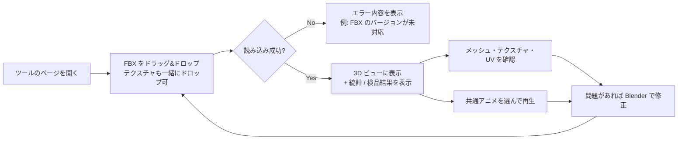

# FBX ビューア 要件定義書

| 項目         | 内容                                                  |
| ------------ | ----------------------------------------------------- |
| ドキュメント | 要件定義（設計の前段階）                              |
| 対象ツール   | `src/tools/fbx-viewer/`（slug: `fbx-viewer`）         |
| ステータス   | ドラフト（[§9 要決定事項](#9-要決定事項) の回答待ち） |
| 最終更新     | 2026-10-10                                            |

---

## 1. 背景と目的

### 1.1 背景

ゲームで使う 3D モデルを、[Tripo](https://www.tripo3d.ai/) などの生成 AI で作り、[Blender](https://www.blender.org/) で手直しして FBX で書き出している。Unity に取り込む前に、次のような問題がないかを確認する工程（**検品**）が必要になる。

- ポリゴン数やテクスチャ解像度が予算を超えていないか
- テクスチャが正しく割り当てられているか、UV が壊れていないか
- スケール・向き・原点（ピボット）が Unity で扱いやすい状態か
- リグが付いている場合、用意したアニメーションで破綻なく動くか

Unity を起動して取り込むと時間がかかるうえ、プロジェクトが汚れる。そのため **ブラウザで開いて、ドラッグ＆ドロップするだけで検品できるツール** を作る。

### 1.2 目的

- FBX をブラウザにドロップするだけで、メッシュ・テクスチャ・UV・アニメーションを確認できるようにする
- 検品項目を自動でチェックし、OK / 警告 / NG で一覧表示して、目視のチェック漏れを減らす
- リポジトリ側で用意した共通アニメーションをモデルに当てて、リグを動かして確認できるようにする

### 1.3 スコープ外（やらないこと）

| やらないこと                                       | 理由                                                                         |
| -------------------------------------------------- | ---------------------------------------------------------------------------- |
| モデルの編集・修正・書き出し                       | 修正は Blender で行う。このツールは閲覧と検品に特化する                      |
| Unity と同じ見た目の再現（独自シェーダ・トゥーン） | ブラウザでは Unity のシェーダを再現できない。ルックの最終確認は Unity で行う |
| サーバへのアップロード・保存・共有                 | テンプレートの方針（クライアントサイドのみ）に従う。社外秘アセットも扱える   |
| FBX 6.x 以前の古い形式                             | 使用するローダーが対応していない（§7 参照）                                  |
| スマートフォン・タブレットでの利用                 | 検品は PC で行う想定                                                         |

---

## 2. 想定ユーザーと利用シーン

### 2.1 想定ユーザー

| ユーザー             | 主な関心                                                 |
| -------------------- | -------------------------------------------------------- |
| モデル作成者（自分） | Blender で修正したあと、書き出しに問題がないか確認したい |
| エンジニア           | Unity に取り込む前に、予算・スケール・リグを確認したい   |

### 2.2 基本の利用フロー



**ポイント：** 修正 → 再ドロップを何度も繰り返す前提。再ドロップしたら前のモデルを破棄して置き換え、カメラ位置やアニメの選択は保持する。

---

## 3. 機能要件

優先度は合意済みの順（見た目と統計 → アニメ → テクスチャ → UV → リグ）で、フェーズに分ける。

| フェーズ | 内容                           | 位置づけ |
| -------- | ------------------------------ | -------- |
| P1       | 読み込み・表示・統計・基本検品 | MVP      |
| P2       | アニメーション                 | MVP      |
| P3       | テクスチャ                     | 拡張     |
| P4       | UV                             | 拡張     |
| P5       | リグ詳細・ウェイト             | 拡張     |

ID の末尾に優先度を付ける：**[必須]** はそのフェーズの完了条件、**[任意]** は余裕があれば実装する。

### 3.1 P1：読み込み・表示・統計・基本検品

#### 読み込み

| ID     | 要件                                                                                                                                    | 優先度 |
| ------ | --------------------------------------------------------------------------------------------------------------------------------------- | ------ |
| F-1-01 | ページ全体を受け口として、FBX をドラッグ＆ドロップで読み込める                                                                          | 必須   |
| F-1-02 | ファイル選択ダイアログからも読み込める（ドラッグ＆ドロップの代わりとアクセシビリティのため）                                            | 必須   |
| F-1-03 | FBX と画像ファイル（png / jpg / tga）を**同時に複数ドロップ**できる。FBX が外部参照しているテクスチャは、ファイル名で照合して割り当てる | 必須   |
| F-1-04 | 読み込み中はローディング表示を出す                                                                                                      | 必須   |
| F-1-05 | 読み込みに失敗したら、原因を日本語で表示する（未対応バージョン、壊れたファイル、FBX 以外など）                                          | 必須   |
| F-1-06 | 再ドロップすると前のモデルを破棄して置き換える（GPU リソースも解放する）                                                                | 必須   |
| F-1-07 | フォルダごとのドロップに対応する                                                                                                        | 任意   |

#### 3D 表示

| ID     | 要件                                                                                   | 優先度 |
| ------ | -------------------------------------------------------------------------------------- | ------ |
| F-1-10 | マウスで回転・パン・ズームできる                                                       | 必須   |
| F-1-11 | 読み込んだら、モデル全体が収まるようにカメラを自動で合わせる。リセットボタンも用意する | 必須   |
| F-1-12 | 地面グリッドと座標軸ギズモを表示する（表示・非表示を切り替えられる）                   | 必須   |
| F-1-13 | 表示モードを切り替えられる：通常 / ワイヤーフレーム / 通常＋ワイヤー                   | 必須   |
| F-1-14 | 背景色を切り替えられる（明・暗・中間グレー）                                           | 必須   |
| F-1-15 | 法線の向きを確認できる（裏面を色付け表示、または法線ベクトルを表示）                   | 任意   |
| F-1-16 | ライティングをプリセットから選べる（環境光のみ / スタジオ風 など）                     | 任意   |

#### 統計情報

| ID     | 要件                                                                                                                                           | 優先度 |
| ------ | ---------------------------------------------------------------------------------------------------------------------------------------------- | ------ |
| F-1-20 | 次の値を表示する：ファイル名、ファイルサイズ、FBX バージョン                                                                                   | 必須   |
| F-1-21 | 次の値を表示する：メッシュ数、頂点数、ポリゴン数（三角形）、マテリアル数、テクスチャ数、ボーン数、アニメーションクリップ数、ブレンドシェイプ数 | 必須   |
| F-1-22 | バウンディングボックスのサイズ（幅・高さ・奥行き、単位 m）を表示する                                                                           | 必須   |
| F-1-23 | ファイルに記録されたスケール係数（UnitScaleFactor）と上方向の軸を表示する                                                                      | 必須   |
| F-1-24 | メッシュごとの内訳（名前・頂点数・ポリゴン数・マテリアル）を表示する                                                                           | 必須   |
| F-1-25 | シーン階層（ノードツリー）を表示する                                                                                                           | 任意   |

#### 検品チェック

ロードしたモデルに対して自動でチェックし、**OK / 警告 / NG** を一覧表示する。閾値は §3.6 の「検品プリセット」で変更できる。

| ID   | チェック項目             | 判定の例                                                                                  | フェーズ | 優先度 |
| ---- | ------------------------ | ----------------------------------------------------------------------------------------- | -------- | ------ |
| C-01 | ポリゴン数               | プリセットの上限を超えたら NG、上限の 80% を超えたら警告                                  | P1       | 必須   |
| C-02 | マテリアル数             | 上限を超えたら警告（ドローコールが増える）                                                | P1       | 必須   |
| C-03 | サイズ（スケール）       | 高さが想定範囲（例: 0.5〜3m）から外れたら警告（cm/m の取り違えを検出）                    | P1       | 必須   |
| C-04 | 原点（ピボット）位置     | 原点が足元（バウンディングボックスの底面中央付近）にない場合は警告                        | P1       | 必須   |
| C-05 | ルートの回転・スケール   | ルートに回転（例: X -90°）やスケール ≠ 1 が残っていたら警告（Blender 書き出し設定の確認） | P1       | 必須   |
| C-06 | UV の有無                | UV0 がないメッシュがあれば NG                                                             | P1       | 必須   |
| C-07 | 法線の有無               | 法線がないメッシュがあれば警告                                                            | P1       | 必須   |
| C-10 | テクスチャの欠落         | 参照しているのに見つからないテクスチャがあれば NG                                         | P3       | 必須   |
| C-11 | テクスチャ解像度         | 上限を超えたら NG、2 のべき乗でなければ警告                                               | P3       | 必須   |
| C-20 | UV の範囲                | 0〜1 の範囲外に UV がはみ出していれば警告                                                 | P4       | 必須   |
| C-21 | UV の重なり              | 重なっている UV があれば警告（意図した重ね置きもあるため NG にはしない）                  | P4       | 任意   |
| C-30 | ボーン数                 | 上限を超えたら警告                                                                        | P5       | 必須   |
| C-31 | 1 頂点あたりのウェイト数 | 4 を超えたら警告（Unity のモバイル向け設定に合わせる。§7 の制約あり）                     | P5       | 任意   |
| C-32 | ウェイトのない頂点       | スキンメッシュでウェイト 0 の頂点があれば NG                                              | P5       | 必須   |

### 3.2 P2：アニメーション

アニメーションの入手元は 2 つ。

| 入手元                           | 説明                                                                             |
| -------------------------------- | -------------------------------------------------------------------------------- |
| **共通アニメ（リポジトリ同梱）** | リポジトリ側で用意した待機・歩き・走りなどのアニメ。一覧から選んでモデルに当てる |
| **モデル内蔵アニメ**             | ドロップした FBX 自体にアニメが含まれている場合                                  |

> ⚠️ 共通アニメをどこから入手してどう配布するかは未決定。[§9 要決定事項 Q1](#9-要決定事項) を参照。

| ID     | 要件                                                                                                 | 優先度                |
| ------ | ---------------------------------------------------------------------------------------------------- | --------------------- |
| F-2-01 | モデル内蔵アニメと共通アニメの両方を、1 つのクリップ一覧で選べる                                     | 必須                  |
| F-2-02 | 再生・一時停止・停止、ループ切り替え、再生速度（0.25x〜2x）を操作できる                              | 必須                  |
| F-2-03 | タイムラインのスライダーでフレーム単位にシークできる。現在のフレーム数と総フレーム数を表示する       | 必須                  |
| F-2-04 | 共通アニメは、選んだときに初めて読み込む（初期表示を軽くするため）                                   | 必須                  |
| F-2-05 | 共通アニメをモデルに当てるときは、**ボーン名で照合**する。`mixamorig:` などの接頭辞の違いは吸収する  | 必須                  |
| F-2-06 | 照合結果を表示する：一致したボーン数 / アニメ側のボーン数、一致しなかったボーン名の一覧              | 必須                  |
| F-2-07 | 一致率が低く当てられない場合は、理由を表示する（例: 「リグがありません」「ボーン名が一致しません」） | 必須                  |
| F-2-08 | ルートモーション（腰の移動）のオン・オフを切り替えられる。オフにするとその場で再生する               | 必須                  |
| F-2-09 | 再生中もスケルトンを重ねて表示できる                                                                 | 必須                  |
| F-2-10 | アニメ FBX をドロップして、一時的にクリップ一覧へ追加できる                                          | 任意                  |
| F-2-11 | ボーン名やレストポーズが異なるリグへのリターゲット                                                   | 任意（P5 以降で検討） |

### 3.3 P3：テクスチャ

| ID     | 要件                                                                                                                 | 優先度 |
| ------ | -------------------------------------------------------------------------------------------------------------------- | ------ |
| F-3-01 | マテリアル一覧と、各マテリアルに割り当てられたテクスチャ（ベースカラー / 法線 / 金属度・粗さ / 発光 など）を表示する | 必須   |
| F-3-02 | 各テクスチャのサムネイル、解像度、埋め込みか外部参照かを表示する                                                     | 必須   |
| F-3-03 | サムネイルをクリックすると拡大表示する                                                                               | 必須   |
| F-3-04 | 3D ビューの表示チャンネルを切り替えられる：通常 / ベースカラーのみ / 法線マップのみ / テクスチャなし（白）           | 必須   |
| F-3-05 | 見つからないテクスチャはマゼンタ色で表示し、一覧に「欠落」と表示する                                                 | 必須   |
| F-3-06 | 後からテクスチャ画像をドロップして、欠落を解消できる                                                                 | 任意   |

### 3.4 P4：UV

| ID     | 要件                                                                   | 優先度 |
| ------ | ---------------------------------------------------------------------- | ------ |
| F-4-01 | UV レイアウトを 2D で表示する（0〜1 の枠つき）                         | 必須   |
| F-4-02 | 表示するメッシュと UV セット（UV0 / UV1）を切り替えられる              | 必須   |
| F-4-03 | UV レイアウトの背景に、そのマテリアルのテクスチャを重ねて表示できる    | 必須   |
| F-4-04 | 3D ビューのテクスチャをチェッカー柄に置き換えて、UV の歪みを確認できる | 必須   |
| F-4-05 | 0〜1 の範囲外にはみ出した面を強調表示する                              | 必須   |
| F-4-06 | 重なっている面を強調表示する                                           | 任意   |
| F-4-07 | UV レイアウトを PNG で保存できる                                       | 任意   |

### 3.5 P5：リグ詳細・ウェイト

| ID     | 要件                                                       | 優先度 |
| ------ | ---------------------------------------------------------- | ------ |
| F-5-01 | ボーン階層をツリーで表示する                               | 必須   |
| F-5-02 | ツリーでボーンを選ぶと、3D ビューで強調表示する            | 必須   |
| F-5-03 | 選んだボーンのウェイトをヒートマップで表示する             | 必須   |
| F-5-04 | バインドポーズ（T ポーズ / A ポーズ）を表示する            | 必須   |
| F-5-05 | Unity の Humanoid に必要なボーンがそろっているかを確認する | 任意   |

### 3.6 共通

| ID     | 要件                                                                                                                          | 優先度 |
| ------ | ----------------------------------------------------------------------------------------------------------------------------- | ------ |
| F-0-01 | 検品の閾値（ポリゴン数・マテリアル数・テクスチャ解像度・ボーン数など）を **プリセット** として選べる。初期値は §9 Q2 で決める | 必須   |
| F-0-02 | 閾値を画面上で一時的に変更できる                                                                                              | 任意   |
| F-0-03 | 最後に選んだプリセット・背景色などの表示設定をブラウザに保存し、次回も引き継ぐ（localStorage）                                | 任意   |
| F-0-04 | 検品結果をテキスト（Markdown）でクリップボードにコピーできる（Slack や PR に貼る用）                                          | 任意   |

---

## 4. 画面構成（ワイヤーフレーム）

PC の横長画面を想定する。左に 3D ビュー、右に情報パネル（タブ切り替え）を置く。

```
┌──────────────────────────────────────────────────────────────────┐
│ FBX ビューア          [ファイルを選択]  プリセット: [モバイル ▼]  │
├────────────────────────────────────────┬─────────────────────────┤
│                                        │[概要][テクスチャ][UV][リグ]│
│                                        │ ── 検品結果 ──            │
│                                        │ ✅ ポリゴン数  12,340/20k │
│           3D ビュー                    │ ⚠️ サイズ    高さ 180m    │
│     （ここにドロップ）                  │ ❌ UV0 なし  Mesh_02      │
│                                        │ ── 統計 ──                │
│                                        │ 頂点 8,201 / マテリアル 2 │
│ [通常|ワイヤー] [背景] [グリッド] [⟲]  │ ...                       │
├────────────────────────────────────────┴─────────────────────────┤
│ アニメ: [Idle ▼] ▶ ⏸ ⏹  🔁  速度[1.0x]  ━━━●━━━━  24 / 60f       │
│ ボーン照合: 52 / 52 一致   ルートモーション [オフ]                 │
└──────────────────────────────────────────────────────────────────┘
```

- モデルを読み込む前は、3D ビューにドロップを促す案内を表示する
- 既存コンポーネントにならって、ダークモードに対応する

---

## 5. 非機能要件

| 分類         | ID    | 要件                                                                                                              |
| ------------ | ----- | ----------------------------------------------------------------------------------------------------------------- |
| セキュリティ | NF-01 | ドロップしたファイルは外部に送信しない。処理はすべてブラウザ内で完結する                                          |
| 対応環境     | NF-02 | PC 版の Chrome / Edge の最新版。WebGL2 が必須                                                                     |
| 性能         | NF-03 | 50 万ポリゴン・テクスチャ 4K×4 枚程度のモデルを、一般的な開発 PC で 5 秒以内に表示できる（目安）                  |
| 性能         | NF-04 | 3D ビューは 30fps 以上で操作できる（上記規模のモデルで）                                                          |
| 性能         | NF-05 | three.js などの重いライブラリは、ツールのページを開いたときに初めて読み込む。トップページの読み込みに影響させない |
| 堅牢性       | NF-06 | 不正なファイルを読み込んでもページが固まったり落ちたりしない。エラーを表示して、再ドロップできる状態に戻す        |
| リソース管理 | NF-07 | モデルを置き換えても、ジオメトリ・テクスチャ・Blob URL が解放されて、メモリが増え続けない                         |
| UI           | NF-08 | 表示文言は日本語。ダークモード対応。入力要素には `aria-label` か `<label>` を付ける                               |
| 保守性       | NF-09 | 解析・検品のロジックは UI から分離した純粋な TypeScript とし、Vitest でテストする（CLAUDE.md の方針）             |
| 品質         | NF-10 | `npm run check` と `npm run e2e` が通る。E2E では、サンプル FBX を読み込んで統計が表示されることを確認する        |

---

## 6. 入力データの想定

| 項目           | 想定                                                          |
| -------------- | ------------------------------------------------------------- |
| 作成元         | Tripo で生成 → Blender で修正 → Blender から FBX で書き出し   |
| FBX バージョン | 7.4 / 7.5（Blender の FBX 書き出しは 7.4 バイナリ）           |
| 形状           | メッシュ 1〜数個。生成直後はポリゴン数が多いことがある        |
| マテリアル     | PBR（ベースカラー / 法線 / 金属度・粗さ）。1〜数枚            |
| テクスチャ     | png / jpg。FBX に埋め込み、または FBX と別ファイル            |
| リグ           | なし、または Tripo の自動リグ / Mixamo / Blender で付けたリグ |
| アニメ         | 基本はリポジトリ側の共通アニメを当てる                        |

**運用上のお願い（ツールのヘルプにも書く）：** Blender から書き出すときに、パスモードを「コピー」にして埋め込みボタンをオンにすると、テクスチャが FBX に埋め込まれ、FBX 1 つをドロップするだけで済む。

---

## 7. 技術的な前提と制約

技術スタックは前回の検討どおり、既存テンプレート（Vite + React + TypeScript + Tailwind）に [three.js](https://threejs.org/) / [@react-three/fiber](https://r3f.docs.pmnd.rs/) / [@react-three/drei](https://drei.docs.pmnd.rs/) を追加する。詳細は設計書で決める。

three.js r169 の [FBXLoader](https://threejs.org/docs/#examples/en/loaders/FBXLoader) のソースで確認した制約：

| 制約           | 内容                                                                                                                                     | 要件への影響                                                                                            |
| -------------- | ---------------------------------------------------------------------------------------------------------------------------------------- | ------------------------------------------------------------------------------------------------------- |
| 対応バージョン | ASCII は 7.0 以上、バイナリは 6400（6.4）以上のみ。それ未満は例外を投げる                                                                | F-1-05 で日本語のエラーメッセージに変換する                                                             |
| スケール係数   | `UnitScaleFactor` は `userData.unitScaleFactor` に記録されるだけで、**スケールには適用されない**                                         | F-1-23 で値を表示し、C-03 の判定に使う                                                                  |
| ウェイト数     | 1 頂点に 5 本以上のウェイトがあると、上位 4 本だけ残して切り捨てる（`console.warn` を出す）                                              | C-31 は読み込み後のデータでは判定できない。警告を検知するか、生データを解析する必要がある（設計で調査） |
| 外部テクスチャ | ブラウザはローカルのパスを直接読めない                                                                                                   | F-1-03 で、ドロップされたファイルと名前で照合する                                                       |
| マテリアル     | Phong 系のマテリアルに変換される                                                                                                         | Unity と見た目が一致しないことを画面上に注記する                                                        |
| PSD            | 読み込めない                                                                                                                             | 欠落として扱い、「PSD は未対応」と表示する                                                              |
| リターゲット   | [SkeletonUtils.retargetClip](https://threejs.org/docs/#examples/en/utils/SkeletonUtils) はあるが、レストポーズの差が大きいと破綻しやすい | MVP ではボーン名の照合のみ（F-2-05）。リターゲットは F-2-11 で別途検討                                  |

---

## 8. フェーズごとの完了条件

| フェーズ | 完了条件                                                                                                                                 |
| -------- | ---------------------------------------------------------------------------------------------------------------------------------------- |
| P1       | サンプル FBX をドロップすると、3D 表示・統計・検品結果（C-01〜C-07）が出る。不正ファイルではエラーが出る。E2E とスクリーンショットがある |
| P2       | 共通アニメを 1 つ以上選んで再生・シークできる。ボーン照合の結果が表示される                                                              |
| P3       | マテリアルとテクスチャの一覧、チャンネル切り替え、欠落表示（C-10, C-11）ができる                                                         |
| P4       | UV レイアウトの表示、チェッカー表示、範囲外の検出（C-20）ができる                                                                        |
| P5       | ボーンツリー、選択ボーンのウェイト表示、C-30 / C-32 ができる                                                                             |

---

## 9. 要決定事項

設計に入る前に決めたいこと。

### Q1. 共通アニメの入手元と配布方法 【重要】

Mixamo のアニメは自分のプロジェクトでは無料で使えるが、**素の FBX ファイルを単体で再配布することは禁止されている** と読める（Adobe 公式 FAQ の転載などによる。正式な判断は最新の[利用規約](https://www.adobe.com/legal/terms.html)で確認が必要）。

このリポジトリはビルドすると GitHub Pages に公開される（`deploy.yml`, `pr-preview.yml`）。そのため、`public/` に Mixamo の FBX を置くと **誰でもダウンロードできる状態 = 再配布** になるおそれがある。

| 案  | 内容                                                                                                | 長所                                         | 短所                                                                                                      |
| --- | --------------------------------------------------------------------------------------------------- | -------------------------------------------- | --------------------------------------------------------------------------------------------------------- |
| A   | CC0 のアニメ素材（例: [Quaternius Universal Animation Library](https://quaternius.com/)）を同梱する | ライセンス上安全。公開リポジトリのままでよい | リグが Mixamo と異なるので、モデルのリグと合わせる必要がある                                              |
| B   | Mixamo のアニメは同梱せず、ユーザーが手元のアニメ FBX をドロップする（F-2-10 を必須に格上げ）       | ライセンス上安全                             | 毎回ドロップする手間がかかる（F-0-03 の仕組みで軽減の余地あり）                                           |
| C   | リポジトリを非公開にし、公開先もアクセス制限のある場所にする                                        | Mixamo をそのまま使える                      | GitHub Pages の公開設定や PR プレビューの仕組みを見直す必要がある。チーム内の配布で済むかは別途確認が必要 |

**提案：** 実装は「アニメの入手元」を差し替えられる設計にしておく（同梱 / ドロップのどちらにも対応）。最初は **案 B ＋ 将来的に案 A** で始めるのが安全。

### Q2. 検品プリセットの初期値

ポリゴン数・マテリアル数・テクスチャ解像度・ボーン数の上限。プロジェクトの基準値があれば教えてほしい。なければ、仮で次のように置く。

| プリセット           | ポリゴン数 | マテリアル数 | テクスチャ最大 | ボーン数 |
| -------------------- | ---------- | ------------ | -------------- | -------- |
| モバイル（キャラ）   | 20,000     | 3            | 2048           | 75       |
| モバイル（背景小物） | 5,000      | 2            | 1024           | —        |
| PC                   | 100,000    | 8            | 4096           | 150      |

### Q3. モデル側のリグの種類

Tripo の自動リグ、Mixamo の自動リグ、Blender で手付け、のどれが主か。ボーン名の照合ルール（F-2-05）に影響する。**ボーン名がわかるサンプル FBX が 1 つあると確実。**

### Q4. GLB / glTF にも対応するか

Tripo は GLB でも書き出せる。three.js の GLTFLoader を使えば少ない工数で対応できる。今回はスコープ外とし、P5 のあとに検討する想定でよいか。

### Q5. E2E 用のサンプルモデル

リポジトリに入れて公開してもよいサンプル FBX が必要。自作（Blender の簡単なリグ付きモデル）か CC0 素材を使う想定。

---

## 10. 参考リンク

- [three.js FBXLoader](https://threejs.org/docs/#examples/en/loaders/FBXLoader) / [ソースコード](https://github.com/mrdoob/three.js/blob/dev/examples/jsm/loaders/FBXLoader.js)
- [three.js AnimationMixer](https://threejs.org/docs/#api/en/animation/AnimationMixer) / [SkeletonHelper](https://threejs.org/docs/#api/en/helpers/SkeletonHelper) / [SkeletonUtils](https://threejs.org/docs/#examples/en/utils/SkeletonUtils)
- [React Three Fiber](https://r3f.docs.pmnd.rs/) / [drei](https://drei.docs.pmnd.rs/)
- [Blender マニュアル：FBX 書き出し](https://docs.blender.org/manual/ja/4.1/addons/import_export/scene_fbx.html)
- [Unity マニュアル：モデルのインポート設定](https://docs.unity3d.com/ja/current/Manual/FBXImporter-Model.html)
- [Mixamo FAQ（Adobe コミュニティへの転載）](https://community.adobe.com/t5/mixamo-discussions/mixamo-faq-licensing-royalties-ownership-eula-and-tos/m-p/13234775)
- [Quaternius Universal Animation Library（CC0）](https://quaternius.com/)
